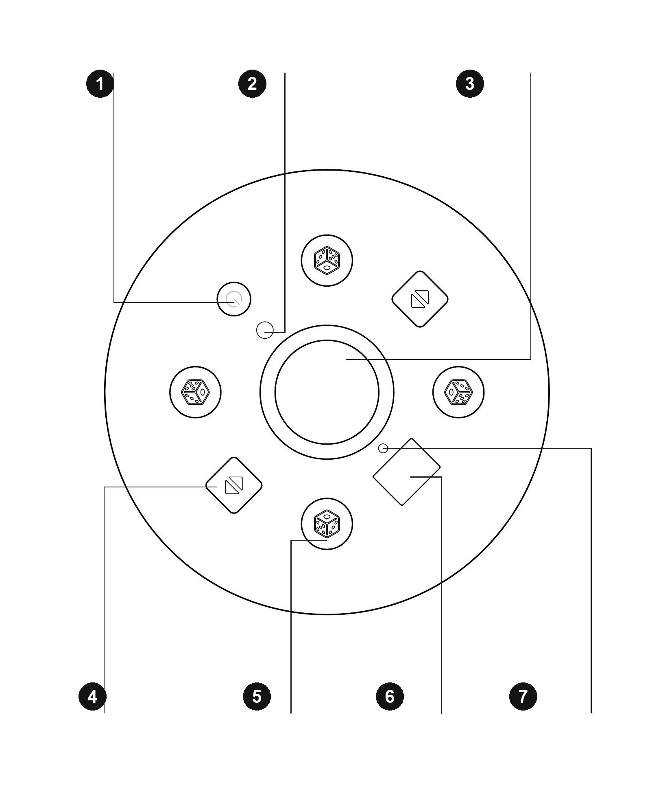

# Control Panel and Basic Operation

Based on the [current user manual](../manuals/text/manual-en.md), updated from the supplied EN / TR / DE manual on 2026-11-12. Confirm the installed model and product rating label before use.

## CONTROL PANEL

Button layout may differ by model. Confirm the symbols on the installed panel before use.

| Number | Control |
|---|---|
| 1 | Power button |
| 2 | Mode button |
| 3 | Dice tray |
| 4 | Panel up/down buttons |
| 5 | Dice-roll buttons |
| 6 | Status display |
| 7 | Position indicators |

## POWER ON / OFF

- Press and hold the power button for 5 seconds to switch the machine on or off.
- To restart from a reset, shuffling or alarm state: hold for 5 seconds to switch off, then hold again for 5 seconds to switch on.

When the machine remains in the reset state with no operation for 30 minutes, it switches off automatically.

## BASIC OPERATION

### 01 Raise / lower the panel

In the reset state, press an up/down button once to raise the centre panel; press it again to lower the panel. During shuffling, press two opposite up/down buttons together to raise the panel and pause. Press one up/down button again to lower the panel and resume.

### 02 Roll the dice

Press the dice-roll button at the required player position. Its position indicator lights and the dice motor runs.

### 03 Return to reset

Press and hold two diagonally opposite dice-roll buttons together for 3 seconds.

---

## Official INEAN PLAY Links

- Website: [ineanplay.com](https://ineanplay.com/)
- WhatsApp: [+86 173 7839 0199](https://wa.me/8617378390199)
- Facebook: [INEAN PLAY](https://www.facebook.com/profile.php?id=61585370578775)
- Instagram: [@ineanplay](https://www.instagram.com/ineanplay/)
- TikTok: [@ineanplay](https://www.tiktok.com/@ineanplay)
- YouTube: [@ineanplay](https://www.youtube.com/@ineanplay)
- Support: [service@ineanplay.com](mailto:service@ineanplay.com)
