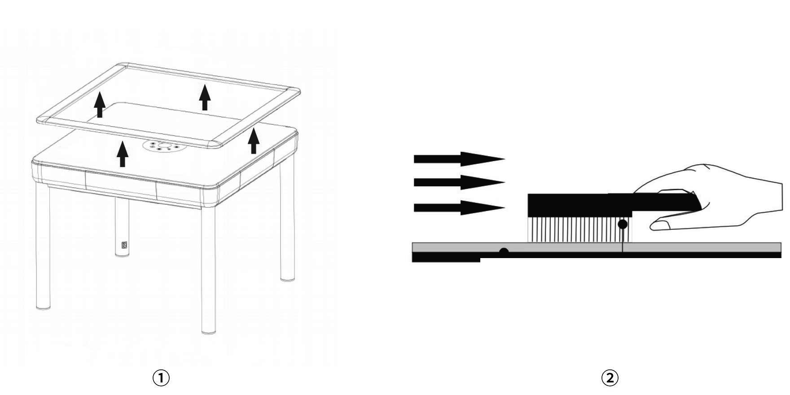
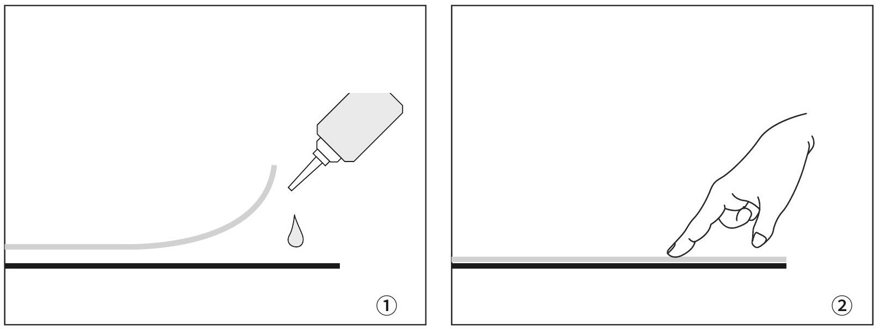
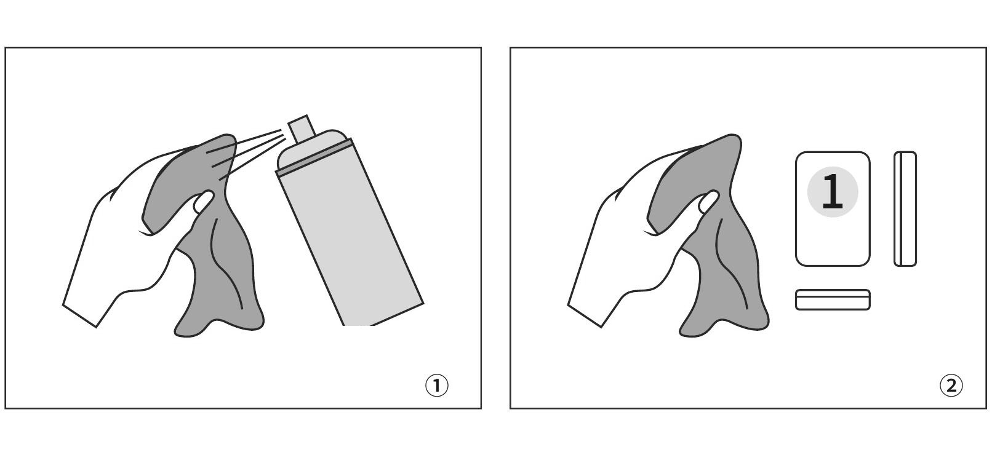
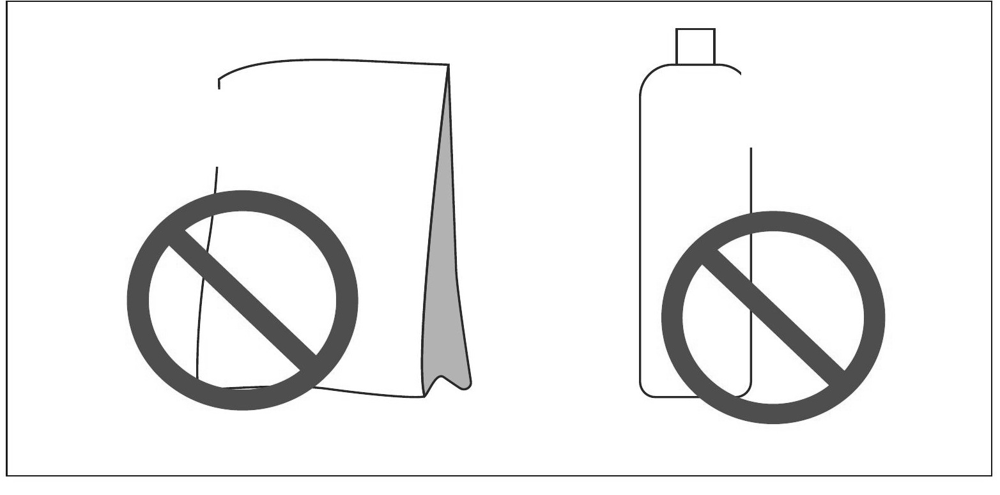

# Automatic OKEY Table Cleaning and Maintenance

Based on the [current user manual](../manuals/text/manual-en.md), updated from the supplied EN / TR / DE manual on 2026-11-12. Confirm the installed model and product rating label before use.

## MAINTENANCE SCHEDULE

1. **After installation / during the first 3 months**. Inspect regularly. Keep the tabletop and compatible tiles clean and dry.
2. **Every 3 months**. Carry out a complete cleaning of the frame, surface fabric and shuffle area. Increase frequency in dusty or high-use locations.
3. **At least 3 times per year**. Arrange comprehensive inspection and maintenance appropriate to usage and local conditions.

### SURFACE FABRIC

Disconnect power. Remove the removable border only if the model permits. With a clean, soft-bristled brush, brush the fabric gently in one direction until dust is removed. Do not soak, scrape or use a stiff brush.

Illustrations show typical configurations. Shape, finish and structure may differ by model.

## SURFACE AND TILE CARE

1. If a fabric edge or corner lifts, stop use. Apply only a small amount of adhesive that is compatible with the fabric and substrate, then press flat until secure. If suitability is uncertain, use qualified service.

2. Arrange the tiles on a clean, flat surface. Lightly dampen a clean cloth with a manufacturer-approved, non-corrosive surface cleaner and wipe all six faces. Never spray cleaner directly into the machine.

3. For engraved faces, use a slightly damp, soft-bristled brush with light pressure. Do not scrub hard enough to remove paint. Dry fully with a soft cloth or cool airflow before loading.

> **IMPORTANT**
> Do not use laundry powder, dishwashing liquid, abrasive cleaners, solvents or aggressive chemicals. These may damage printing, surface finish or magnetic properties.

## INTERIOR MAINTENANCE

1. Disconnect the power plug before opening any service-access area.
2. Remove loose dust from the shuffle area with a low-suction vacuum or a soft brush.
3. Do not move, bend or force electrical or mechanical components while cleaning.
4. Keep tile-contact and sliding areas clean. Use only the lubricant type and quantity specified for the model.
5. Do not apply surface cleaner to internal parts. If debris cannot be removed safely, arrange qualified service.

---

## Official INEAN PLAY Links

- Website: [ineanplay.com](https://ineanplay.com/)
- WhatsApp: [+86 173 7839 0199](https://wa.me/8617378390199)
- Facebook: [INEAN PLAY](https://www.facebook.com/profile.php?id=61585370578775)
- Instagram: [@ineanplay](https://www.instagram.com/ineanplay/)
- TikTok: [@ineanplay](https://www.tiktok.com/@ineanplay)
- YouTube: [@ineanplay](https://www.youtube.com/@ineanplay)
- Support: [service@ineanplay.com](mailto:service@ineanplay.com)
