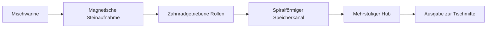

# So funktioniert die automatische OKEY-Mechanik

[English](../en/working-principle.md) · [Türkçe](../tr/working-principle.md) · [Deutsch](working-principle.md) · [Übersicht](../README.md)

Die hier beschriebene Mechanik verbindet Mischen, magnetische Steinaufnahme, Transport und Ausgabe auf die Spielfläche. Diese Übersicht gilt für automatische OKEY-Tische mit dieser Mechanik. Prüfen Sie die Ausstattung des gewählten Modells; Mahjong-Mechaniken und andere Steuerungen benötigen ihre eigene Dokumentation.

## 1. Mischen mit kontrollierter Bewegung

Zwei Motoren treiben die Mischwanne symmetrisch über Präzisionszahnräder an. Eine bewegliche Steinführung dreht sich in derselben Richtung wie die Wanne; ihre Bewegung wird durch Software gesteuert. Diese Anordnung verringert gegenläufige Widerstände beim Mischen.

Eine zweilagige Dämpfungsfläche federt die Stöße der in die Wanne fallenden Steine ab. Zusammen unterstützen diese Merkmale einen gleichmäßigeren Lauf und weichere Steinaufpralle.

## 2. Magnetische Aufnahme und kurzer Transportweg

Ein Motor treibt das magnetische Aufnahmerad direkt an. Präzisionszahnräder bewegen zwei Transportrollen. Die Steuerschaltung der Aufnahme regelt den Aufnahmezeitpunkt und die Abstände zwischen den Steinen.

Direktantrieb und Zahnräder ersetzen Riemen und Federspanner im Aufnahmegetriebe. Der kürzere Transportweg hilft, das Gegeneinanderdrücken von Steinen am Eingang zu reduzieren. Der Verzicht auf Riemen und Federspanner in diesem Antrieb verringert die zugehörigen Einstellarbeiten. Verwenden Sie ausschließlich den für das Modell vorgesehenen, kompatiblen magnetischen Steinsatz.

## 3. Speichern, Anheben und Ausgeben

Die Steine durchlaufen einen Speicherkanal in Form einer archimedischen Spirale. Ein flexibler Schieber bringt die Kraft an zwei Kontaktpunkten auf und bewegt die Steinreihe gleichmäßig. Der Hubweg besteht aus aufeinanderfolgenden Abschnitten mit 18° und 9°, die einen sanften Übergang auf die Spielfläche ermöglichen.

Die Mechanik führt ausgerichtete Steinreihen zur Tischmitte. Dadurch müssen die ausgegebenen Reihen seltener von Hand nach innen geschoben werden.

## 4. Bedienung und Fehlerzuordnung

Die beschriebene OKEY-Konfiguration unterstützt die Modi OKEY und 101. Befolgen Sie zur Moduswahl die [Bedienungsanleitung](../../../manuals/text/manual-de.md#section-07) und verwenden Sie die freigegebene Steinkonfiguration.

Die lokale Fehlerdiagnose hilft, die betroffene Mechanik und Seite zu erkennen. Ein angezeigter Code bezeichnet einen Prüfbereich; er beweist nicht, dass ein bestimmtes Bauteil defekt ist. Notieren Sie für den Support den Code und die blinkende Positionsanzeige.

## Weiterführende Informationen

- [Konstruktionsmerkmale und tägliche Nutzung](design-and-use.md)
- [F&E-Messwerte und ihr Geltungsbereich](rd-measurements.md)
- [Bedienungsanleitung](../../../manuals/text/manual-de.md)
- [Fehlercodes](../../../manuals/text/manual-de.md#section-09)

_Zuletzt aktualisiert: 2026-11-12._
