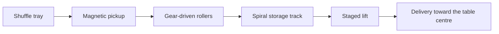

# How the automatic OKEY mechanism works

[English](working-principle.md) · [Türkçe](../tr/working-principle.md) · [Deutsch](../de/working-principle.md) · [Guide index](../README.md)

The mechanism described here combines shuffling, magnetic pickup, tile transport and delivery to the playing surface. This overview applies to automatic OKEY tables equipped with this mechanism. Confirm the configuration of the selected model; Mahjong mechanisms and other controllers need their own documentation.

## 1. Shuffling with controlled movement

Two motors drive the shuffle tray symmetrically through precision gears. A dynamic tile guide rotates in the same direction as the tray, while software controls its movement. This arrangement reduces opposing resistance during shuffling.

A two-layer cushioning surface absorbs tile impacts as tiles enter the tray. Together, these features support smoother movement and softer tile impacts.

## 2. Magnetic pickup and short transport

A motor directly drives the magnetic pickup wheel. Precision gears drive two transport rollers, and the pickup control circuit manages pickup timing and spacing between tiles.

The direct-drive and gear arrangement replaces belts and spring tensioners in the pickup transmission. A shorter transport path helps reduce tiles pushing against one another at the entrance. Removing belts and spring tensioners from this drive reduces the related adjustment tasks. Use only the compatible magnetic tile set specified for the model.

## 3. Storage, lifting and delivery

Tiles travel through an Archimedean spiral storage track. A flexible pusher applies force at two contact points to move the row evenly. The lift follows successive 18° and 9° sections, providing a gradual transition to the playing surface.

The mechanism brings aligned tile rows toward the centre of the table, reducing the need to push the delivered rows inward by hand.

## 4. Controls and fault identification

The described OKEY configuration supports OKEY and 101 modes. Follow the [user manual](../../../manuals/text/manual-en.md#section-07) for mode selection and use the approved tile configuration.

Local fault diagnostics help identify the affected mechanism and side. A displayed code identifies an area for inspection; it does not prove that a particular component has failed. Record the code and flashing position indicator for support.

## Continue reading

- [Design features and everyday use](design-and-use.md)
- [R&D measurements and their scope](rd-measurements.md)
- [Operating instructions](../../../manuals/text/manual-en.md)
- [Fault-code guide](../../fault-codes.md)

_Last updated: 2026-11-12._
