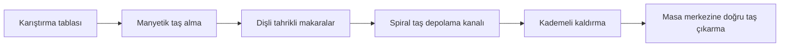

# Otomatik OKEY mekanizması nasıl çalışır?

[English](../en/working-principle.md) · [Türkçe](working-principle.md) · [Deutsch](../de/working-principle.md) · [Rehber dizini](../README.md)

Burada açıklanan mekanizma; karıştırma, manyetik taş alma, taşıma ve oyun yüzeyine çıkarma işlemlerini bir araya getirir. Bu açıklama, söz konusu mekanizmayla donatılmış otomatik OKEY masaları için geçerlidir. Seçilen modelin yapılandırmasını doğrulayın; mahjong mekanizmaları ve farklı kontrol sistemleri için kendi belgeleri kullanılmalıdır.

## 1. Kontrollü hareketle karıştırma

İki motor, hassas dişliler üzerinden karıştırma tablasını simetrik olarak tahrik eder. Hareketli taş kılavuzu tablayla aynı yönde döner; hareketi yazılımla kontrol edilir. Bu düzen, karıştırma sırasında ters yöndeki direnci azaltır.

İki katmanlı darbe sönümleyici yüzey, taşlar tablaya girerken darbeleri yumuşatır. Bu özellikler birlikte daha dengeli harekete ve daha yumuşak taş darbelerine katkıda bulunur.

## 2. Manyetik taş alma ve kısa taşıma yolu

Bir motor, manyetik taş alma çarkını doğrudan tahrik eder. Hassas dişliler iki taşıma makarasını çalıştırır; taş alma kontrol devresi, alma zamanlamasını ve taşlar arasındaki mesafeyi düzenler.

Doğrudan tahrik ve dişli düzeni, taş alma aktarımındaki kayışların ve yaylı gergi mekanizmalarının yerini alır. Daha kısa taşıma yolu, girişte taşların birbirini itmesini azaltmaya yardımcı olur. Bu tahrikten kayışların ve yaylı gergi mekanizmalarının kaldırılması, ilgili ayar işlerini azaltır. Yalnızca model için belirtilen uyumlu manyetik taş takımını kullanın.

## 3. Depolama, kaldırma ve taş çıkarma

Taşlar, Arşimet spirali biçimindeki depolama kanalından geçer. Esnek itici, iki temas noktasından kuvvet uygulayarak taş sırasını dengeli biçimde ilerletir. Kaldırma yolu, oyun yüzeyine yumuşak geçiş sağlayan ardışık 18° ve 9° bölümlerden oluşur.

Mekanizma, hizalanmış taş sıralarını masanın merkezine doğru çıkarır ve çıkan sıraları elle içeri itme ihtiyacını azaltır.

## 4. Kontroller ve arıza tespiti

Açıklanan OKEY yapılandırması, OKEY ve 101 modlarını destekler. Mod seçimi için [kullanım kılavuzunu](../../../manuals/text/manual-tr.md#section-07) izleyin ve onaylı taş yapılandırmasını kullanın.

Cihaz üzerindeki arıza tanılama sistemi, ilgili mekanizmanın ve yönün belirlenmesine yardımcı olur. Görüntülenen kod, incelenecek alanı belirtir; belirli bir parçanın kesin arızalı olduğunu kanıtlamaz. Destek için kodu ve yanıp sönen konum göstergesini kaydedin.

## İlgili bilgiler

- [Tasarım özellikleri ve günlük kullanım](design-and-use.md)
- [Ar-Ge ölçümleri ve kapsamları](rd-measurements.md)
- [Kullanım talimatları](../../../manuals/text/manual-tr.md)
- [Arıza kodları](../../../manuals/text/manual-tr.md#section-09)

_Son güncelleme: 2026-11-12._

---

## Resmi INEAN PLAY bağlantıları

- Web sitesi: [ineanplay.com](https://ineanplay.com/)
- E-posta: [service@ineanplay.com](mailto:service@ineanplay.com)
- WhatsApp: [+86 173 7839 0199](https://wa.me/8617378390199)
- Facebook: [INEAN PLAY](https://www.facebook.com/profile.php?id=61585370578775)
- Instagram: [@ineanplay](https://www.instagram.com/ineanplay/)
- TikTok: [@ineanplay](https://www.tiktok.com/@ineanplay)
- YouTube: [@ineanplay](https://www.youtube.com/@ineanplay)
