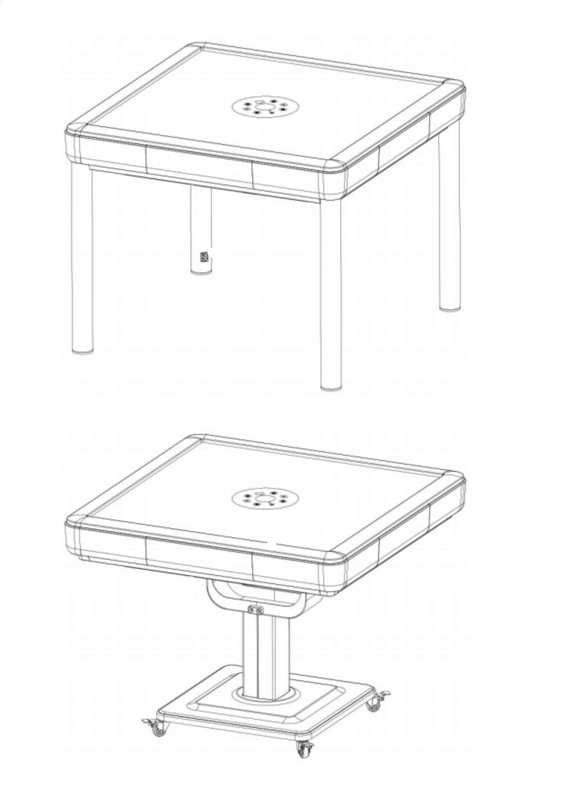
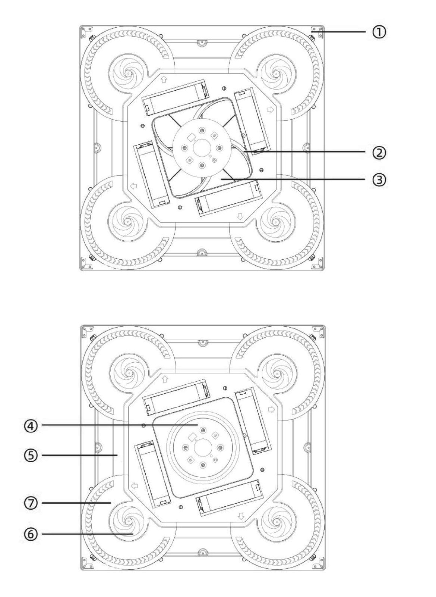
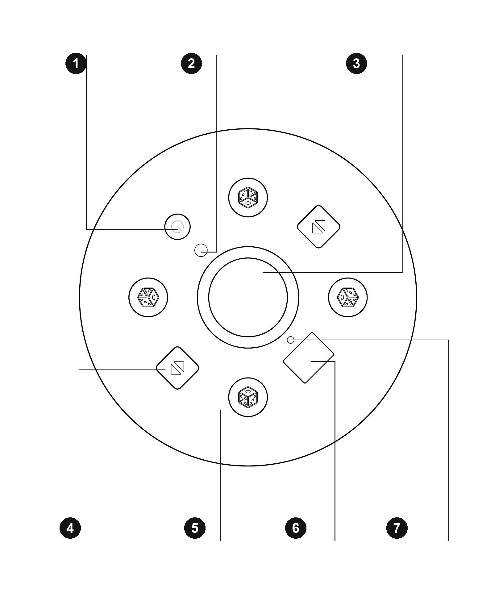
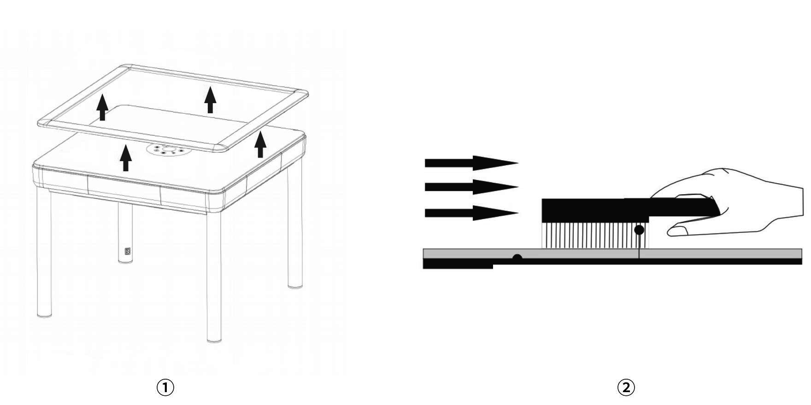
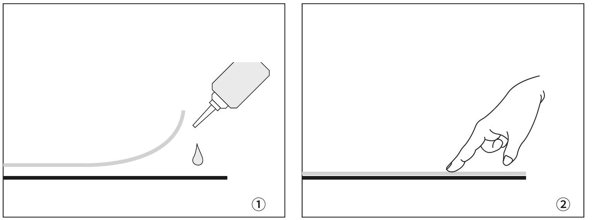
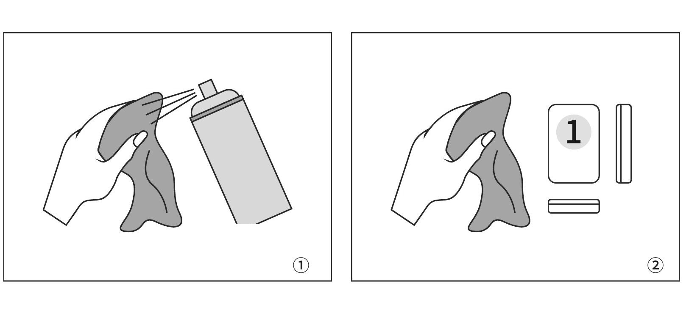
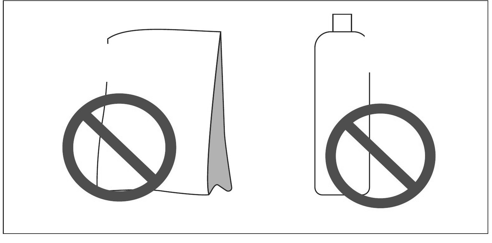

# Automatischer OKEY-Tisch - Bedienungsanleitung

> **Modellzuordnung.** Verwenden Sie die Anleitung, die zu Ihrem Modell und Bedienfeld passt. INEAN PLAY hilft Ihnen bei der Auswahl anhand eines Typenschildfotos.

Lesen Sie diese Anleitung vor Aufstellung, Bedienung, Reinigung oder Wartung vollständig durch.

_Am 2026-11-12 anhand der bereitgestellten A5-White-Label-Anleitung aktualisiert, deutsche Seiten 36-52. Der Text folgt der Quelle; das vollständige bebilderte Layout befindet sich im Original-PDF._

[Vollständige bebilderte Anleitung (EN / TR / DE)](../pdf/Automatic_OKEY_Table_User_Manual_EN-TR-DE.pdf) | [Deutsches PDF](../pdf/INEAN_PLAY_OTOKEY_User_Manual_DE.pdf)

## Inhalt

- [01 SICHERHEIT UND VERWENDUNG](#section-01)
- [02 PRODUKTÜBERSICHT](#section-02)
- [03 KOMPONENTEN DER HAUPTEINHEIT](#section-03)
- [04 BEDIENFELD](#section-04)
- [05 EIN- / AUSSCHALTEN](#section-05)
- [06 GRUNDBEDIENUNG](#section-06)
- [07 OKEY- / 101-MODUS](#section-07)
- [08 SERVICEDIAGNOSE](#section-08)
- [09 FEHLERCODES](#section-09)
- [10 WARTUNGSPLAN](#section-10)
- [11 OBERFLÄCHEN- UND SPIELSTEINPFLEGE](#section-11)
- [12 INNENREINIGUNG](#section-12)
- [13 GARANTIE- UND SERVICEBEDINGUNGEN](#section-13)

## 01 SICHERHEIT UND VERWENDUNG

Für einen sicheren, zuverlässigen Betrieb sind die folgenden Hinweise und die Angaben auf dem Typenschild zu beachten.

- Verwenden Sie nur für dieses Modell geeignete, freigegebene Spielsteine, Zubehör- und Ersatzteile.
- Gerät nicht selbst zerlegen, verändern oder reparieren. Arbeiten im Inneren dürfen nur von qualifiziertem Servicepersonal ausgeführt werden.
- Nur an eine geerdete Steckdose anschließen, die den örtlichen Vorschriften sowie Spannung und Frequenz auf dem Typenschild entspricht.
- Bei instabilem Netz geeigneten Spannungsschutz verwenden. Gerät nicht außerhalb der angegebenen Nennwerte betreiben.
- Gerät beim Transport aufrecht und stabil halten; nicht umdrehen, fallen lassen oder Stößen aussetzen.
- Tischfläche und Innenraum nicht mit Wasser abwaschen. Flüssigkeiten von elektrischen Teilen fernhalten.
- Feuerzeuge, Zigarettenreste, Münzen und andere Kleinteile dürfen nicht in das Gerät gelangen.
- Spielfläche und Spielsteine nicht mit scharfen Gegenständen zerkratzen.
- Bei längerer Lagerung Netzstecker ziehen und vor direkter Sonne, übermäßiger Wärme und hoher Luftfeuchte schützen.
- Bei Störungen Betrieb stoppen, Netzstecker ziehen und durch qualifiziertes Personal prüfen lassen.
- Eine beschädigte Netzleitung darf nur durch qualifiziertes Personal mit einer geeigneten Leitung ersetzt werden.

> **WICHTIG**
> Verwenden Sie den für das Gerät vorgesehenen Spielsteinsatz. Falsche Abmessungen, Gewichte oder magnetische Eigenschaften können Blockaden, Sortierfehler oder Schäden verursachen. Ausführung und Bedienelemente können je nach Modell abweichen; maßgeblich ist das tatsächliche Produkt.

## 02 PRODUKTÜBERSICHT

Das Produkt besteht aus der Haupttischeinheit, einem Außenrahmen und einem Untergestell. Je nach Modell besitzt das Untergestell vier Beine oder einen fahrbaren Standfuß. Zwei kompatible OKEY-Spielsteinsätze können mitgeliefert werden.

Die Abbildungen zeigen typische Ausführungen. Form, Oberfläche und Aufbau können modellabhängig abweichen.

## 03 KOMPONENTEN DER HAUPTEINHEIT

Die Haupteinheit verbindet elektronische Steuerung und mechanische Handhabung. Die nummerierte Darstellung zeigt die Hauptbaugruppen.

| Nummer | Komponente |
|---|---|
| 1 | Außenrahmen |
| 2 | Sortierführung |
| 3 | Mischwanne |
| 4 | Würfelfach-Baugruppe |
| 5 | Förderer-Baugruppe |
| 6 | Drehteller |
| 7 | Sortierbaugruppe |

## 04 BEDIENFELD

Die Tastenanordnung kann modellabhängig abweichen. Prüfen Sie vor der Bedienung die Symbole am eingebauten Bedienfeld.

| Nummer | Bedienelement |
|---|---|
| 1 | Ein-/Aus-Taste |
| 2 | Modus-Taste |
| 3 | Würfelfach |
| 4 | Hubtasten (auf/ab) |
| 5 | Würfeltasten |
| 6 | Statusanzeige |
| 7 | Positionsanzeigen |

## 05 EIN- / AUSSCHALTEN

- Ein-/Aus-Taste 5 Sekunden gedrückt halten, um das Gerät ein- oder auszuschalten.
- Neustart aus Grundstellung, Mischbetrieb oder Alarmzustand: Zum Ausschalten 5 Sekunden gedrückt halten, danach zum Einschalten erneut 5 Sekunden gedrückt halten.

Bleibt das Gerät im Grundstellung (Reset) 30 Minuten unbedient, schaltet es sich automatisch aus.

## 06 GRUNDBEDIENUNG

### 01 Mittelteil anheben / absenken

In Grundstellung (Reset) eine Hubtaste einmal drücken, um das Mittelteil anzuheben, und erneut drücken, um es abzusenken. Während des Mischens zwei gegenüberliegende Hubtasten gleichzeitig drücken: Das Mittelteil fährt hoch und der Vorgang pausiert. Eine Hubtaste erneut drücken, um abzusenken und fortzufahren.

### 02 Würfeln

Die Würfeltaste an der gewünschten Spielerposition drücken. Die zugehörige Positionsanzeige leuchtet und der Würfelmotor läuft.

### 03 In den Grundstellung (Reset) wechseln

Zwei diagonal gegenüberliegende Würfeltasten gemeinsam 3 Sekunden gedrückt halten.

## 07 OKEY- / 101-MODUS

1. Gerät in den Grundstellung (Reset) versetzen.
2. Modus-Taste 5 Sekunden gedrückt halten.
3. Ein Signal ertönt und die Anzeige wechselt zwischen OKEY und 101.
4. Den 5-Sekunden-Tastendruck wiederholen, um zurückzuschalten.

## 08 SERVICEDIAGNOSE

> WICHTIG: Der Diagnosemodus setzt interne Mechanismen in Bewegung. Nur für geschulte Prüfungen bei freier Spielfläche verwenden.

In Grundstellung alle vier Würfeltasten gemeinsam 3 Sekunden gedrückt halten. Zum Beenden alle vier Tasten erneut gemeinsam gedrückt halten; das Gerät kehrt zum Mischbetrieb zurück.

- 0 - Zentralhub
- 1 - Hauptdrehteller
- 2 - Transporteinheiten an allen vier Seiten
- 3 - Stapel- und Schiebeeinheiten an allen vier Seiten
- 4 - Spielstein-Hubeinheiten an allen vier Seiten
- 5 - Drehbasis-/Spielstein-Schiebeeinheiten an allen vier Seiten
- 6 - Würfelmotor und Signalgeber
- 7 - automatischer Dauerlauftest

## 09 FEHLERCODES

Ein Fehlercode bezeichnet den zu prüfenden Funktionsbereich; er weist nicht zwingend auf ein defektes Bauteil hin. Bei den Codegruppen 21-54 kennzeichnet die letzte Ziffer die Seite. Die zugehörige Positionsanzeige blinkt. Tritt der Fehler nach einem Neustart erneut auf, Betrieb stoppen.

Für Gruppen 21-54: 1 Ost · 2 Süd · 3 West · 4 Nord

| CODE | FUNKTIONSBEREICH |
|---|---|
| 00 | Zentralhub |
| 01 | Hauptdrehteller |
| 21 | Transporteinheit Ost |
| 22 | Transporteinheit Süd |
| 23 | Transporteinheit West |
| 24 | Transporteinheit Nord |
| 31 | Stapel- und Schiebeeinheit Ost |
| 32 | Stapel- und Schiebeeinheit Süd |
| 33 | Stapel- und Schiebeeinheit West |
| 34 | Stapel- und Schiebeeinheit Nord |
| 41 | Spielstein-Hubeinheit Ost |
| 42 | Spielstein-Hubeinheit Süd |
| 43 | Spielstein-Hubeinheit West |
| 44 | Spielstein-Hubeinheit Nord |
| 51 | Drehbasiseinheit Ost |
| 52 | Drehbasiseinheit Süd |
| 53 | Drehbasiseinheit West |
| 54 | Drehbasiseinheit Nord |

## 10 WARTUNGSPLAN

1. **Nach Aufstellung / in den ersten 3 Monaten**. Regelmäßig prüfen. Tischfläche und passende Spielsteine sauber und trocken halten.
2. **Alle 3 Monate**. Rahmen, Oberflächenstoff und Mischbereich gründlich reinigen. Bei Staub oder intensiver Nutzung häufiger reinigen.
3. **Mindestens 3-mal pro Jahr**. Eine umfassende, an Nutzung und Umgebung angepasste Inspektion und Wartung durchführen lassen.

### OBERFLÄCHENSTOFF

Stromversorgung trennen. Abnehmbare Umrandung nur entfernen, wenn das Modell dies zulässt. Den Stoff mit einer sauberen, weichen Bürste vorsichtig in eine Richtung abbürsten. Nicht durchnässen, schaben oder mit harter Bürste bearbeiten.

Die Abbildungen zeigen typische Ausführungen. Form, Oberfläche und Aufbau können modellabhängig abweichen.

## 11 OBERFLÄCHEN- UND SPIELSTEINPFLEGE

1. Hebt sich eine Stoffkante oder Ecke, Betrieb stoppen. Sehr wenig materialverträglichen Klebstoff auftragen und flach andrücken, bis die Stelle sicher hält. Bei unklarer Materialverträglichkeit qualifizierten Service einsetzen.

2. Spielsteine auf einer sauberen, ebenen Fläche anordnen. Ein sauberes Tuch mit einem freigegebenen, nicht korrosiven Oberflächenreiniger leicht anfeuchten und alle sechs Seiten abwischen. Reiniger nie direkt in das Gerät sprühen.

3. Gravierte Vorderseiten mit einer leicht feuchten, weichen Bürste und geringem Druck reinigen. Nicht so stark bürsten, dass Farbe abgetragen wird. Vor dem Einlegen vollständig mit weichem Tuch oder kalter Luft trocknen.

> **WICHTIG**
> Kein Waschpulver, Spülmittel, Scheuermittel, Lösungsmittel oder aggressive Chemikalien verwenden. Sie können Aufdruck, Oberfläche oder magnetische Eigenschaften beschädigen.

## 12 INNENREINIGUNG

1. Vor dem Öffnen eines Servicezugangs den Netzstecker ziehen.
2. Losen Staub im Mischbereich mit schwacher Saugleistung oder weicher Bürste entfernen.
3. Elektrische oder mechanische Teile bei der Reinigung nicht bewegen, verbiegen oder mit Kraft belasten.
4. Kontakt- und Gleitbereiche der Spielsteine sauber halten. Nur die für das Modell angegebene Schmierstoffart und -menge verwenden.
5. Oberflächenreiniger nicht auf Innenteile auftragen. Lässt sich Schmutz nicht sicher entfernen, qualifizierten Service einsetzen.

## 13 GARANTIE- UND SERVICEBEDINGUNGEN

> **INEAN PLAY Gerätegarantie — Repository-Hinweis.** Bei INEAN PLAY gekaufte automatische OKEY- und Mahjong-Tische haben eine einjährige beschränkte Gerätegarantie **ab Lieferung**; gesetzliche Verbraucherrechte gelten zusätzlich. Umfang und Serviceabläufe finden Sie in der [Garantie](https://ineanplay.com/de/pages/warranty) und der [Rückgaberichtlinie](https://ineanplay.com/de/pages/return-policy).

Garantiedauer und Serviceumfang ergeben sich aus Kaufvertrag, Rechnung oder der mitgelieferten Garantieunterlage. Zwingende gesetzliche Rechte bleiben unberührt.

- Kaufnachweis, Garantieunterlage und Seriennummer des Produkts aufbewahren.
- Fertigungs- oder Materialfehler werden nach der jeweils geltenden Garantieunterlage behandelt.
- Service außerhalb der Garantie kann Arbeits-, Fahrt- und Ersatzteilkosten umfassen.
- Spielsteine, Außenverkleidung und Spielflächenstoff sind Verschleißteile, sofern die Garantie nichts anderes festlegt.

### Typische Ausschlüsse

- Garantiezeit abgelaufen oder Nachweis der Deckung nicht vorhanden.
- Seriennummer oder Garantieangaben verändert, entfernt oder dem Gerät nicht zuzuordnen.
- Schäden durch falschen Transport, Aufstellung, Gebrauch, Reinigung, Wartung oder Lagerung.
- Schäden durch unbefugtes Zerlegen, Reparieren oder Verändern.
- Schäden durch ungeeignete Stromversorgung, Temperatur, Feuchte, Flüssigkeitseintritt oder Ereignisse außerhalb angemessener Kontrolle.

---

## Produkte ansehen und Angebot anfordern

- [Automatischer OKEY-Tisch mit festem Untergestell](https://ineanplay.com/products/inean-otokey)
- [Klappbarer automatischer OKEY-Tisch](https://ineanplay.com/products/inean-otokey-f)

[Angebot anfordern](https://ineanplay.com/pages/contact). Geben Sie Modell, Stückzahl sowie Lieferland und -ort an, damit wir ein vollständiges Angebot erstellen können.

## Offizielle INEAN PLAY Links

- Website: [ineanplay.com](https://ineanplay.com/)
- E-Mail: [service@ineanplay.com](mailto:service@ineanplay.com)
- WhatsApp: [+86 173 7839 0199](https://wa.me/8617378390199)
- Facebook: [INEAN PLAY](https://www.facebook.com/profile.php?id=61585370578775)
- Instagram: [@ineanplay](https://www.instagram.com/ineanplay/)
- TikTok: [@ineanplay](https://www.tiktok.com/@ineanplay)
- YouTube: [@ineanplay](https://www.youtube.com/@ineanplay)
