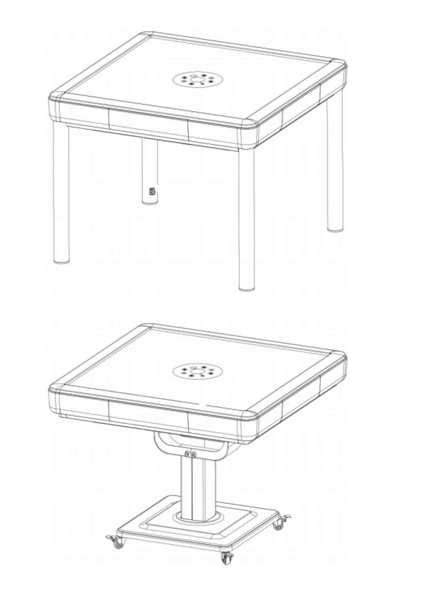
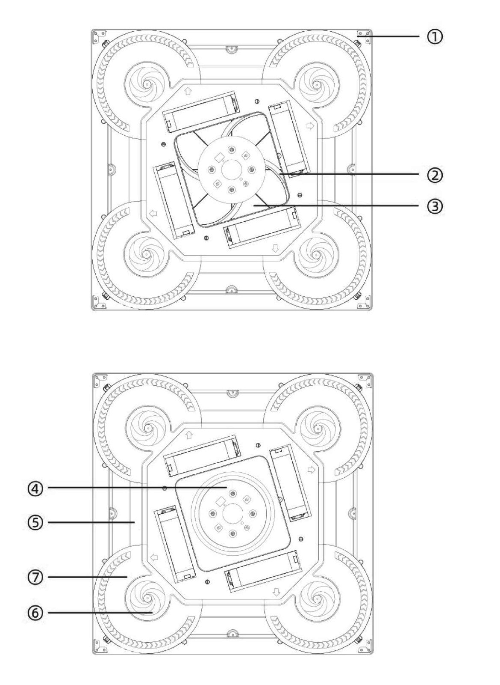
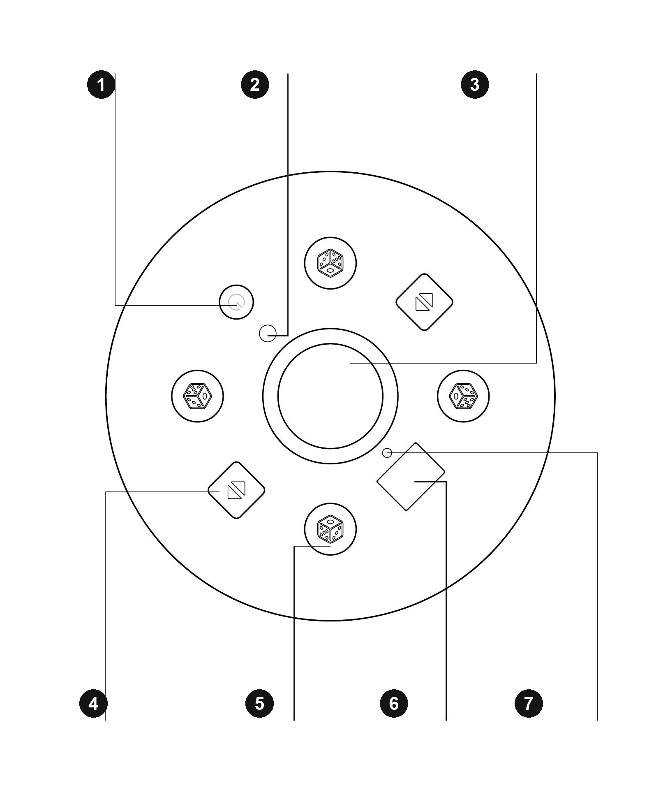
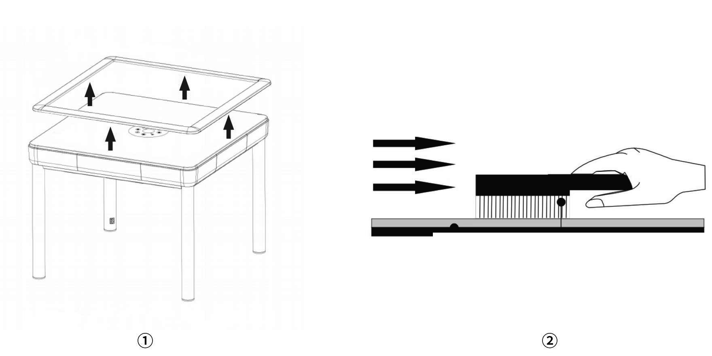
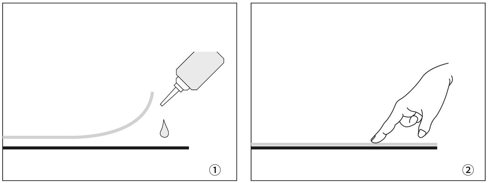
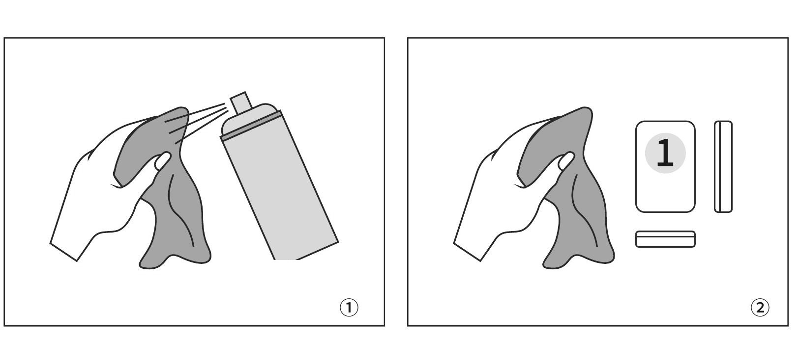
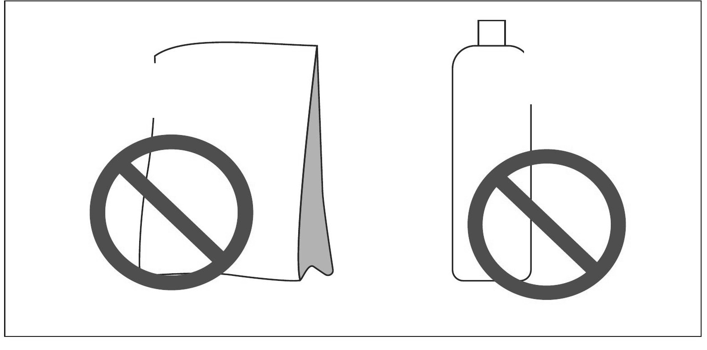

# Automatic OKEY Table - User Manual

Read this manual completely before installation, operation, cleaning or servicing.

_Updated on 2026-11-12 from the supplied white-label A5 manual, English pages 2-18. The text follows the source; the original PDF contains the complete illustrated layout._

[Complete illustrated manual (EN / TR / DE)](../pdf/Automatic_OKEY_Table_User_Manual_EN-TR-DE.pdf) | [English PDF](../pdf/INEAN_PLAY_OTOKEY_User_Manual_EN.pdf)

## Contents

- [01 SAFETY AND INTENDED USE](#section-01)
- [02 PRODUCT OVERVIEW](#section-02)
- [03 MAIN UNIT COMPONENTS](#section-03)
- [04 CONTROL PANEL](#section-04)
- [05 POWER ON / OFF](#section-05)
- [06 BASIC OPERATION](#section-06)
- [07 OKEY / 101 MODE](#section-07)
- [08 SERVICE DIAGNOSTICS](#section-08)
- [09 FAULT CODES](#section-09)
- [10 MAINTENANCE SCHEDULE](#section-10)
- [11 SURFACE AND TILE CARE](#section-11)
- [12 INTERIOR MAINTENANCE](#section-12)
- [13 WARRANTY AND SERVICE TERMS](#section-13)

## 01 SAFETY AND INTENDED USE

For safe, reliable operation, observe all instructions below and the product rating label.

- Use only compatible tiles, accessories and replacement parts approved for this model.
- Do not dismantle, modify or repair the machine yourself. Internal work is for qualified service personnel only.
- Connect to a grounded outlet that complies with local electrical rules and the voltage/frequency shown on the product rating label.
- If the mains supply is unstable, use suitable voltage-protection equipment. Do not operate outside the product rating.
- Transport the machine upright and stable. Do not invert, drop or subject it to impact.
- Do not wash the tabletop or interior with water. Keep liquids away from electrical parts.
- Prevent lighters, cigarette ends, coins and other small objects from entering the machine.
- Do not scratch the playing surface or tiles with sharp objects.
- For long storage, disconnect power and avoid direct sunlight, excessive heat and high humidity.
- If a fault occurs, stop use and disconnect power before inspection by qualified personnel.
- A damaged power cord must be replaced by qualified personnel using a suitable cord.

> **IMPORTANT**
> Use the tile set specified for the machine. Incorrect tile size, weight or magnetic properties may cause jams, sorting errors or damage. Appearance and controls may vary by model; the actual product takes precedence.

## 02 PRODUCT OVERVIEW

The product consists of the main table unit, an outer frame and a supporting base. Depending on the model, the base may use four legs or a mobile pedestal. Two compatible OKEY tile sets may be supplied.

Illustrations show typical configurations. Shape, finish and structure may differ by model.

## 03 MAIN UNIT COMPONENTS

The main unit combines electronic control and mechanical handling systems. The numbered diagram identifies the principal assemblies.

| Number | Component |
|---|---|
| 1 | Outer frame |
| 2 | Sorting guide |
| 3 | Shuffle tray |
| 4 | Dice-tray assembly |
| 5 | Conveyor assembly |
| 6 | Rotating tray |
| 7 | Sorting assembly |

## 04 CONTROL PANEL

Button layout may differ by model. Confirm the symbols on the installed panel before use.

| Number | Control |
|---|---|
| 1 | Power button |
| 2 | Mode button |
| 3 | Dice tray |
| 4 | Panel up/down buttons |
| 5 | Dice-roll buttons |
| 6 | Status display |
| 7 | Position indicators |

## 05 POWER ON / OFF

- Press and hold the power button for 5 seconds to switch the machine on or off.
- To restart from a reset, shuffling or alarm state: hold for 5 seconds to switch off, then hold again for 5 seconds to switch on.

When the machine remains in the reset state with no operation for 30 minutes, it switches off automatically.

## 06 BASIC OPERATION

### 01 Raise / lower the panel

In the reset state, press an up/down button once to raise the centre panel; press it again to lower the panel. During shuffling, press two opposite up/down buttons together to raise the panel and pause. Press one up/down button again to lower the panel and resume.

### 02 Roll the dice

Press the dice-roll button at the required player position. Its position indicator lights and the dice motor runs.

### 03 Return to reset

Press and hold two diagonally opposite dice-roll buttons together for 3 seconds.

## 07 OKEY / 101 MODE

1. Place the machine in the reset state.
2. Press and hold the Mode button for 5 seconds.
3. A beep sounds and the display changes between OKEY and 101.
4. Repeat the 5-second press to switch back.

## 08 SERVICE DIAGNOSTICS

> IMPORTANT: Diagnostic mode operates internal mechanisms. Use it only for trained inspection with the playing area clear.

In the reset state, hold all four dice-roll buttons together for 3 seconds to enter the test. To exit, hold all four buttons together again; the machine returns to shuffling.

- 0 - centre-panel lift
- 1 - main turntable
- 2 - transport units on all four sides
- 3 - stacking and pushing units on all four sides
- 4 - tile-lift units on all four sides
- 5 - rotary-base / tile-pushing units on all four sides
- 6 - dice motor and buzzer
- 7 - automatic endurance test

## 09 FAULT CODES

A fault code identifies the function area to inspect; it does not by itself prove that a component has failed. In code groups 21-54, the last digit identifies the side. The corresponding position indicator flashes. Stop operation if the fault repeats after a restart.

For groups 21-54: 1 East · 2 South · 3 West · 4 North

| CODE | FAULT AREA |
|---|---|
| 00 | Centre-panel lift |
| 01 | Main turntable |
| 21 | East transport unit |
| 22 | South transport unit |
| 23 | West transport unit |
| 24 | North transport unit |
| 31 | East stacking and pushing unit |
| 32 | South stacking and pushing unit |
| 33 | West stacking and pushing unit |
| 34 | North stacking and pushing unit |
| 41 | East tile-lift unit |
| 42 | South tile-lift unit |
| 43 | West tile-lift unit |
| 44 | North tile-lift unit |
| 51 | East rotary-base unit |
| 52 | South rotary-base unit |
| 53 | West rotary-base unit |
| 54 | North rotary-base unit |

## 10 MAINTENANCE SCHEDULE

1. **After installation / during the first 3 months**. Inspect regularly. Keep the tabletop and compatible tiles clean and dry.
2. **Every 3 months**. Carry out a complete cleaning of the frame, surface fabric and shuffle area. Increase frequency in dusty or high-use locations.
3. **At least 3 times per year**. Arrange comprehensive inspection and maintenance appropriate to usage and local conditions.

### SURFACE FABRIC

Disconnect power. Remove the removable border only if the model permits. With a clean, soft-bristled brush, brush the fabric gently in one direction until dust is removed. Do not soak, scrape or use a stiff brush.

Illustrations show typical configurations. Shape, finish and structure may differ by model.

## 11 SURFACE AND TILE CARE

1. If a fabric edge or corner lifts, stop use. Apply only a small amount of adhesive that is compatible with the fabric and substrate, then press flat until secure. If suitability is uncertain, use qualified service.

2. Arrange the tiles on a clean, flat surface. Lightly dampen a clean cloth with a manufacturer-approved, non-corrosive surface cleaner and wipe all six faces. Never spray cleaner directly into the machine.

3. For engraved faces, use a slightly damp, soft-bristled brush with light pressure. Do not scrub hard enough to remove paint. Dry fully with a soft cloth or cool airflow before loading.

> **IMPORTANT**
> Do not use laundry powder, dishwashing liquid, abrasive cleaners, solvents or aggressive chemicals. These may damage printing, surface finish or magnetic properties.

## 12 INTERIOR MAINTENANCE

1. Disconnect the power plug before opening any service-access area.
2. Remove loose dust from the shuffle area with a low-suction vacuum or a soft brush.
3. Do not move, bend or force electrical or mechanical components while cleaning.
4. Keep tile-contact and sliding areas clean. Use only the lubricant type and quantity specified for the model.
5. Do not apply surface cleaner to internal parts. If debris cannot be removed safely, arrange qualified service.

## 13 WARRANTY AND SERVICE TERMS

Warranty duration and service coverage are defined by the sales contract, invoice or warranty document supplied with the product. Mandatory rights under local law remain unaffected.

- Keep proof of purchase, the warranty document and the product serial number.
- Defects caused by manufacturing or material faults are handled according to the applicable warranty document.
- Service outside the warranty may include labour, travel and replacement-part charges.
- Tiles, outer trim and playing-surface fabric are wear items unless the applicable warranty states otherwise.

### Typical exclusions

- Warranty period expired or proof of coverage unavailable.
- Serial number or warranty information altered, removed or mismatched.
- Damage caused by incorrect transport, installation, use, cleaning, maintenance or storage.
- Damage caused by unauthorised dismantling, repair or modification.
- Damage caused by unsuitable power, temperature, humidity, liquid ingress or events outside reasonable control.

---

## Official INEAN PLAY links

- Website: [ineanplay.com](https://ineanplay.com/)
- Email: [service@ineanplay.com](mailto:service@ineanplay.com)
- WhatsApp: [+86 173 7839 0199](https://wa.me/8617378390199)
- Facebook: [INEAN PLAY](https://www.facebook.com/profile.php?id=61585370578775)
- Instagram: [@ineanplay](https://www.instagram.com/ineanplay/)
- TikTok: [@ineanplay](https://www.tiktok.com/@ineanplay)
- YouTube: [@ineanplay](https://www.youtube.com/@ineanplay)
