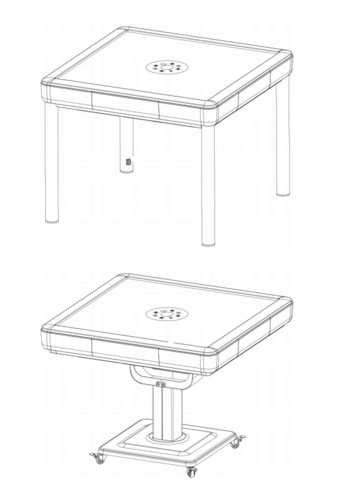
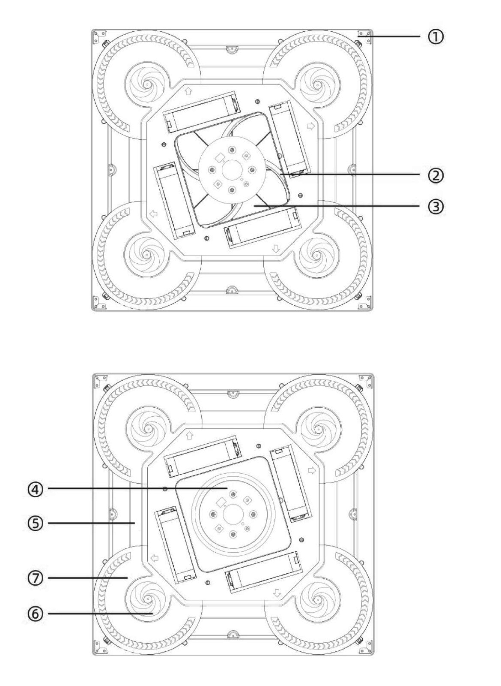
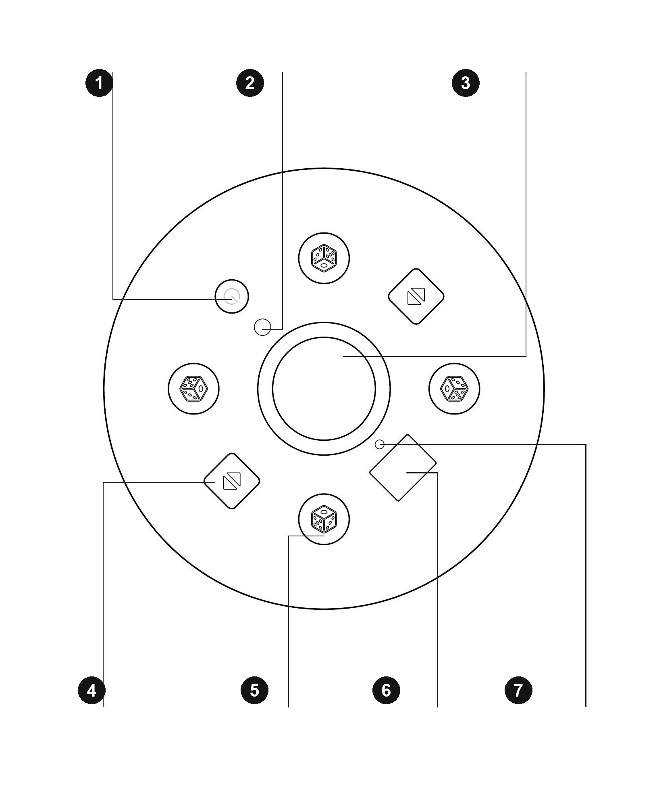
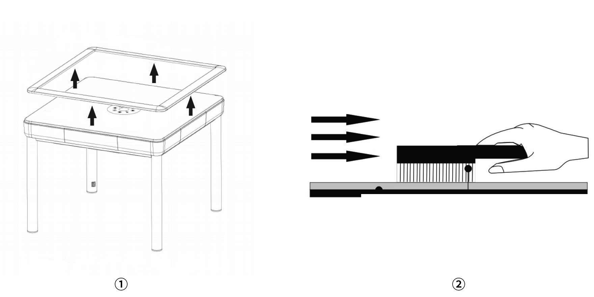
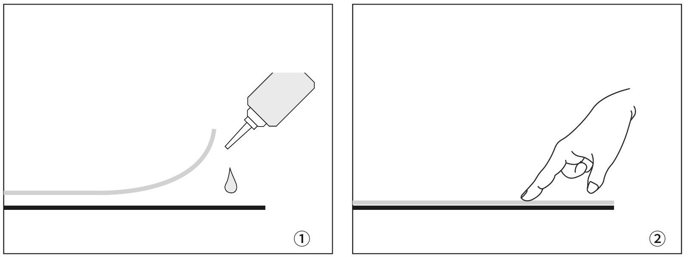
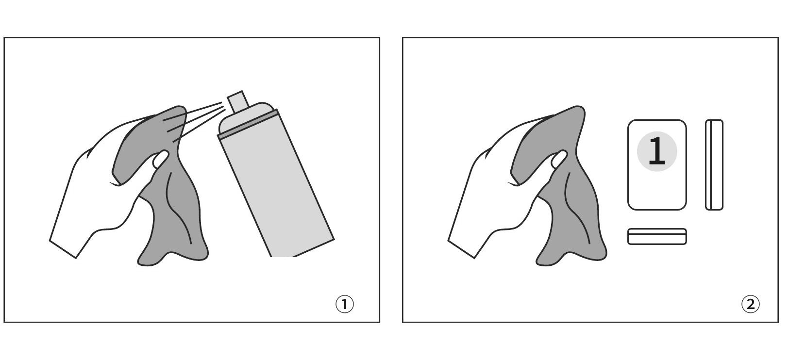
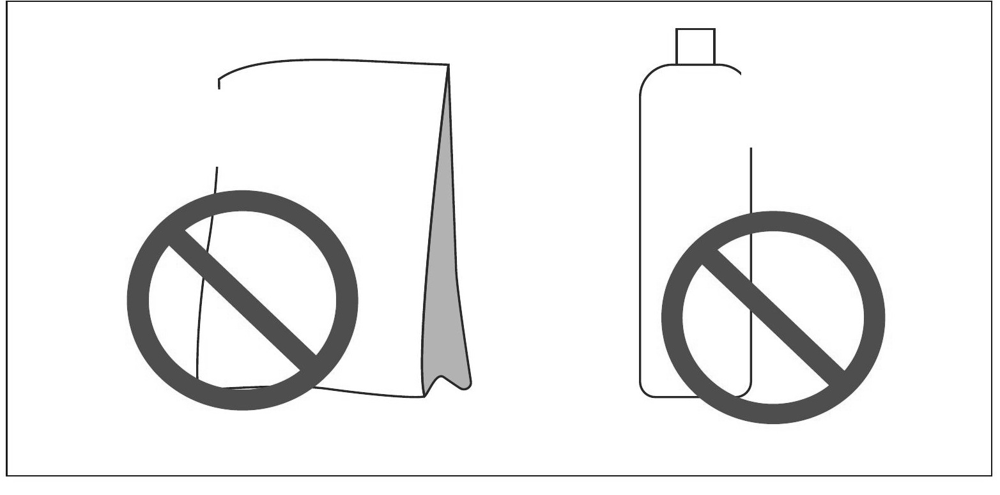

# Otomatik OKEY Masası - Kullanım Kılavuzu

> **Model kapsamı.** Modelinize ve kontrol panelinize uygun talimatları kullanın. Kılavuz seçimi için ürün etiketi fotoğrafıyla INEAN PLAY’e ulaşın.

Kurulum, kullanım, temizlik veya servis öncesinde bu kılavuzun tamamını okuyun.

_2026-11-12 tarihinde sağlanan A5 beyaz etiketli kılavuzun Türkçe 19-35. sayfalarına göre güncellenmiştir. Metin kaynakla aynıdır; tam resimli düzen orijinal PDF’dedir._

[Tam resimli kılavuz (EN / TR / DE)](../pdf/Automatic_OKEY_Table_User_Manual_EN-TR-DE.pdf) | [Türkçe PDF](../pdf/INEAN_PLAY_OTOKEY_User_Manual_TR.pdf)

## İçindekiler

- [01 GÜVENLİK VE KULLANIM AMACI](#section-01)
- [02 ÜRÜN GENEL GÖRÜNÜMÜ](#section-02)
- [03 ANA ÜNİTE BİLEŞENLERİ](#section-03)
- [04 KONTROL PANELİ](#section-04)
- [05 AÇMA / KAPAMA](#section-05)
- [06 TEMEL KULLANIM](#section-06)
- [07 OKEY / 101 MODU](#section-07)
- [08 SERVİS TANILAMA MODU](#section-08)
- [09 ARIZA KODLARI](#section-09)
- [10 BAKIM PROGRAMI](#section-10)
- [11 YÜZEY VE TAŞ BAKIMI](#section-11)
- [12 MAKİNE İÇİ BAKIM](#section-12)
- [13 GARANTİ VE SERVİS KOŞULLARI](#section-13)

## 01 GÜVENLİK VE KULLANIM AMACI

Güvenli ve kararlı çalışma için aşağıdaki talimatlara ve ürün etiketindeki değerlere uyun.

- Yalnızca bu modelle uyumlu, onaylanmış taşları, aksesuarları ve yedek parçaları kullanın.
- Makineyi kendiniz sökmeyin, değiştirmeyin veya onarmayın. İç müdahaleler yalnızca yetkin servis personeli tarafından yapılmalıdır.
- Ürün etiketinde belirtilen gerilim/frekansa ve yerel kurallara uygun, topraklı bir prize bağlayın.
- Şebeke kararsızsa uygun gerilim koruma ekipmanı kullanın. Ürünü etikette belirtilen değerlerin dışında çalıştırmayın.
- Taşıma sırasında makineyi dik ve dengeli tutun; ters çevirmeyin, düşürmeyin ve darbeye maruz bırakmayın.
- Masa yüzeyini veya iç bölümü suyla yıkamayın; sıvıları elektrikli parçalardan uzak tutun.
- Çakmak, sigara izmariti, bozuk para ve benzeri küçük cisimlerin makineye girmesini önleyin.
- Oyun yüzeyini veya taşları keskin cisimlerle çizmeyin.
- Uzun süreli depolamada fişi çekin; doğrudan güneş, aşırı sıcaklık ve yüksek nemden koruyun.
- Arıza halinde kullanımı durdurun, gücü kesin ve yetkin personele kontrol ettirin.
- Hasarlı güç kablosu, uygun bir kabloyla yalnızca yetkin personel tarafından değiştirilmelidir.

> **ÖNEMLİ**
> Makine için belirtilen taş takımını kullanın. Uygun olmayan boyut, ağırlık veya manyetik özellik; sıkışma, sıralama hatası ya da hasara neden olabilir. Görünüm ve kontroller modele göre değişebilir; gerçek ürün esas alınmalıdır.

## 02 ÜRÜN GENEL GÖRÜNÜMÜ

Ürün; ana masa ünitesi, dış çerçeve ve taşıyıcı tabandan oluşur. Modele bağlı olarak taban dört ayaklı veya hareketli kaideli olabilir. İki uyumlu OKEY taş takımı ürünle birlikte verilebilir.

Çizimler tipik yapılandırmaları gösterir. Şekil, yüzey ve yapı modele göre farklı olabilir.

## 03 ANA ÜNİTE BİLEŞENLERİ

Ana ünite elektronik kontrol ve mekanik taşıma sistemlerini bir araya getirir. Numaralı şema temel bileşenleri gösterir.

| Numara | Bileşen |
|---|---|
| 1 | Dış çerçeve |
| 2 | Sıralama kılavuzu |
| 3 | Karıştırma tablası |
| 4 | Zar tablası ünitesi |
| 5 | Konveyör ünitesi |
| 6 | Döner tabla |
| 7 | Sıralama ünitesi |

## 04 KONTROL PANELİ

Düğme yerleşimi modele göre değişebilir. Kullanımdan önce kurulu paneldeki simgeleri kontrol edin.

| Numara | Kontrol |
|---|---|
| 1 | Güç düğmesi |
| 2 | Mod düğmesi |
| 3 | Zar bölmesi |
| 4 | Panel kaldırma/indirme düğmeleri |
| 5 | Zar atma düğmeleri |
| 6 | Durum ekranı |
| 7 | Konum göstergeleri |

## 05 AÇMA / KAPAMA

- Makineyi açmak veya kapatmak için güç düğmesini 5 saniye basılı tutun.
- Sıfırlama, karıştırma veya alarm durumundan yeniden başlatmak için tuşu 5 saniye basılı tutarak kapatın; ardından tekrar 5 saniye basılı tutarak açın.

Makine sıfırlama durumunda 30 dakika işlem görmezse otomatik olarak kapanır.

## 06 TEMEL KULLANIM

### 01 Orta bölümü kaldırma / indirme

Başlangıç konumunda (sıfırlama durumu) kaldırma/indirme düğmesine bir kez basarak orta bölümü kaldırın; yeniden basarak indirin. Karıştırma sırasında karşılıklı iki kaldırma/indirme düğmesine birlikte basmak orta bölümü kaldırır ve işlemi duraklatır; düğmelerden birine yeniden basmak bölümü indirir ve karıştırmayı sürdürür.

### 02 Zar atma

İstenen oyuncu yönündeki zar düğmesine basın. İlgili konum göstergesi yanar ve zar motoru çalışır.

### 03 Sıfırlama durumuna dönme

Çapraz karşılıklı iki zar düğmesini birlikte 3 saniye basılı tutun.

## 07 OKEY / 101 MODU

1. Makineyi sıfırlama durumuna getirin.
2. Mod düğmesini 5 saniye basılı tutun.
3. Bir uyarı sesi duyulur ve ekran OKEY ile 101 arasında değişir.
4. Geri dönmek için 5 saniyelik basışı tekrarlayın.

## 08 SERVİS TANILAMA MODU

> ÖNEMLİ: Tanılama modu iç mekanizmaları çalıştırır. Yalnızca eğitimli kontrol sırasında ve oyun alanı boşken kullanın.

Sıfırlama durumunda dört zar atma tuşunu birlikte 3 saniye basılı tutarak teste girin. Çıkmak için dört tuşu yeniden birlikte basılı tutun; makine karıştırmaya döner.

- 0 - orta bölüm kaldırma mekanizması
- 1 - ana döner tabla
- 2 - dört yöndeki taşıma birimleri
- 3 - dört yöndeki istifleme ve itme birimleri
- 4 - dört yöndeki taş kaldırma birimleri
- 5 - dört yöndeki döner taban / taş itme birimleri
- 6 - zar motoru ve sesli uyarıcı
- 7 - otomatik uzun süreli çalışma testi

## 09 ARIZA KODLARI

Arıza kodu, kontrol edilmesi gereken işlev alanını gösterir; tek başına bir parçanın kesin arızalı olduğu anlamına gelmez. 21-54 kod gruplarında son rakam yönü belirtir. İlgili konum göstergesi yanıp söner. Yeniden başlatmadan sonra kod tekrarlanırsa kullanımı durdurun.

21-54 gruplarında: 1 Doğu · 2 Güney · 3 Batı · 4 Kuzey

| KOD | ARIZA BÖLGESİ |
|---|---|
| 00 | Orta bölüm kaldırma mekanizması |
| 01 | Ana döner tabla |
| 21 | Doğu taşıma birimi |
| 22 | Güney taşıma birimi |
| 23 | Batı taşıma birimi |
| 24 | Kuzey taşıma birimi |
| 31 | Doğu istifleme ve itme birimi |
| 32 | Güney istifleme ve itme birimi |
| 33 | Batı istifleme ve itme birimi |
| 34 | Kuzey istifleme ve itme birimi |
| 41 | Doğu taş kaldırma birimi |
| 42 | Güney taş kaldırma birimi |
| 43 | Batı taş kaldırma birimi |
| 44 | Kuzey taş kaldırma birimi |
| 51 | Doğu döner taban birimi |
| 52 | Güney döner taban birimi |
| 53 | Batı döner taban birimi |
| 54 | Kuzey döner taban birimi |

## 10 BAKIM PROGRAMI

1. **Kurulum sonrası / ilk 3 ay**. Düzenli kontrol yapın. Masa yüzeyini ve uyumlu taşları temiz ve kuru tutun.
2. **Her 3 ayda bir**. Çerçeve, yüzey kumaşı ve karıştırma alanını kapsamlı biçimde temizleyin. Tozlu veya yoğun kullanımlı alanlarda sıklığı artırın.
3. **Yılda en az 3 kez**. Kullanım ve ortam koşullarına uygun kapsamlı kontrol ve bakım yaptırın.

### YÜZEY KUMAŞI

Gücü kesin. Model izin veriyorsa sökülebilir kenarlığı çıkarın. Temiz, yumuşak kıllı bir fırçayla kumaşı tek yönde ve hafifçe fırçalayarak tozu alın. Islatmayın, kazımayın ve sert fırça kullanmayın.

Çizimler tipik yapılandırmaları gösterir. Şekil, yüzey ve yapı modele göre farklı olabilir.

## 11 YÜZEY VE TAŞ BAKIMI

1. Kumaş kenarı veya köşesi kalkarsa kullanımı durdurun. Kumaş ve alt yüzeyle uyumlu yapıştırıcıdan çok az uygulayın; sabitlenene kadar düz bastırın. Uygunluktan emin değilseniz yetkin servise başvurun.

2. Taşları temiz ve düz bir yüzeye dizin. Temiz bir bezi, onaylı ve aşındırıcı olmayan yüzey temizleyiciyle hafifçe nemlendirin; her taşın altı yüzünü silin. Temizleyiciyi doğrudan makineye püskürtmeyin.

3. Oyma yazılı yüzleri hafif nemli, yumuşak kıllı bir fırçayla ve az basınçla temizleyin. Boyayı kaldıracak kadar sert fırçalamayın. Yüklemeden önce yumuşak bez veya soğuk hava akımıyla tamamen kurutun.

> **ÖNEMLİ**
> Çamaşır tozu, bulaşık deterjanı, aşındırıcı temizleyici, çözücü veya güçlü kimyasal kullanmayın. Bunlar baskıya, yüzey kaplamasına ya da manyetik özelliklere zarar verebilir.

## 12 MAKİNE İÇİ BAKIM

1. Servis erişim bölgesini açmadan önce fişi prizden çekin.
2. Karıştırma alanındaki gevşek tozu düşük emişli süpürge veya yumuşak fırçayla alın.
3. Temizlik sırasında elektrikli ya da mekanik parçaları hareket ettirmeyin, bükmeyin veya zorlamayın.
4. Taş temas ve kayma bölgelerini temiz tutun. Yalnızca model için belirtilen tür ve miktarda yağlayıcı kullanın.
5. Yüzey temizleyicisini iç parçalara uygulamayın. Kalıntı güvenle çıkarılamıyorsa yetkin servis kullanın.

## 13 GARANTİ VE SERVİS KOŞULLARI

> **INEAN PLAY mağaza garantisi — depo notu.** INEAN PLAY’den alınan otomatik OKEY ve Mahjong masaları **teslim tarihinden itibaren** bir yıllık sınırlı ekipman garantisine sahiptir; yasal tüketici hakları da geçerlidir. Kapsam ve servis düzenlemeleri için [garanti](https://ineanplay.com/tr/pages/warranty) ve [iade politikasına](https://ineanplay.com/tr/pages/return-policy) bakın.

Garanti süresi ve servis kapsamı; ürünle verilen satış sözleşmesi, fatura veya garanti belgesiyle belirlenir. Yerel mevzuattan doğan zorunlu haklar saklıdır.

- Satın alma belgesini, garanti belgesini ve ürün seri numarasını saklayın.
- Üretim veya malzeme kusurlarından kaynaklanan arızalar ilgili garanti belgesine göre değerlendirilir.
- Garanti dışı servis; işçilik, yol ve yedek parça ücretlerini içerebilir.
- İlgili garanti aksi belirtmedikçe taşlar, dış çerçeve ve oyun yüzeyi kumaşı aşınan parçalardır.

### Tipik garanti dışı durumlar

- Garanti süresinin bitmesi veya kapsam belgesinin sunulamaması.
- Seri numarası ya da garanti bilgilerinin değiştirilmesi, silinmesi veya ürünle uyuşmaması.
- Yanlış taşıma, kurulum, kullanım, temizlik, bakım veya depolamadan doğan hasarlar.
- Yetkisiz sökme, onarım veya değişiklikten doğan hasarlar.
- Uygunsuz elektrik, sıcaklık, nem, sıvı girişi veya makul kontrol dışındaki olaylardan doğan hasarlar.

---

## Resmi INEAN PLAY bağlantıları

- Web sitesi: [ineanplay.com](https://ineanplay.com/)
- E-posta: [service@ineanplay.com](mailto:service@ineanplay.com)
- WhatsApp: [+86 173 7839 0199](https://wa.me/8617378390199)
- Facebook: [INEAN PLAY](https://www.facebook.com/profile.php?id=61585370578775)
- Instagram: [@ineanplay](https://www.instagram.com/ineanplay/)
- TikTok: [@ineanplay](https://www.tiktok.com/@ineanplay)
- YouTube: [@ineanplay](https://www.youtube.com/@ineanplay)
